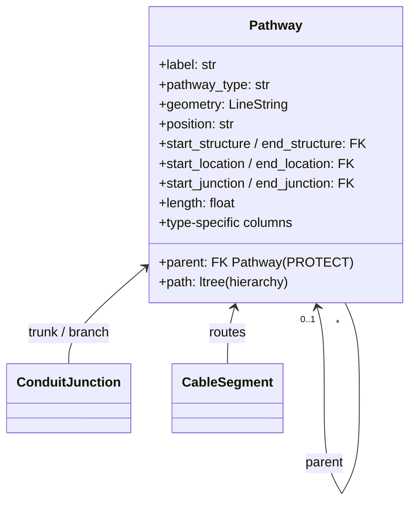

# Architecture

This page describes the internal architecture of NetBox Pathways for developers extending or contributing to the plugin.

## Project Structure

```
netbox_pathways/
├── __init__.py              # PluginConfig
├── models.py                # All Django models
├── choices.py               # ChoiceSet classes
├── registry.py              # Map layer registry (cross-plugin integration)
├── geo.py                   # SRID helpers
├── search.py                # Global search indexes
├── navigation.py            # Plugin menu items
├── admin.py                 # Django admin registrations
├── forms.py                 # NetBox forms (model + filter)
├── tables.py                # NetBox table classes
├── filtersets.py             # Django filter sets
├── views.py                 # View classes (list, detail, edit, delete, map)
├── urls.py                  # URL routing
├── api/
│   ├── urls.py              # API URL routing (REST + GeoJSON)
│   ├── views.py             # DRF ViewSets
│   ├── serializers.py       # DRF serializers
│   ├── geo.py               # GeoJSON ViewSets + serializers
│   ├── external_geo.py      # External layer GeoJSON endpoint
│   └── traversal.py         # Graph traversal endpoints
├── ui/
│   └── panels.py            # NetBox layout panels
├── templates/
│   └── netbox_pathways/
│       ├── map.html          # Interactive map template
│       └── ...               # Detail/form templates
├── static/
│   └── netbox_pathways/
│       ├── src/              # TypeScript source
│       │   ├── pathways-map.ts
│       │   ├── sidebar.ts
│       │   ├── popover.ts
│       │   ├── detail-map.ts
│       │   ├── external-layers.ts
│       │   └── types/
│       ├── dist/             # Built JS bundles (gitignored)
│       ├── css/
│       ├── vendor/           # Leaflet, MarkerCluster
│       └── qgis/             # QGIS style files
└── management/
    └── commands/
        └── generate_qgis_project.py
```

Two modules carry the pathway type rules and the upgrade: `pathway_types.py`
(per-type metadata, below) and `upgrade.py` (the tested helpers the 0.5.0 data
migrations call).

## Data Model

### One Pathway Model

Every pathway type is a row of one concrete `Pathway` model, a NetBox
`LtreeModel` and `NetBoxModel`. There is no multi-table inheritance and no
proxy model, following NetBox core (`Interface.type`, `Cable.type`): the
`pathway_type` field selects the type, and the type-specific columns are
nullable or blank columns on the same table. A single table is also what
netbox-branching needs to provision, edit and merge pathways.



`LtreeModel` hard-codes an ltree column named `path` (its trigger SQL uses
the column name literally), so the route geometry is named `geometry`,
matching `Structure.geometry`. Ancestors and descendants are single ltree
queries (`get_ancestors()`, `get_descendants()`, the `path__descendant`
lookup), and the database triggers re-path a whole subtree when a pathway
moves under a new parent.

### Type Metadata

`pathway_types.py` is the single source of per-type rules. `PATHWAY_TYPES`
maps each `pathway_type` to a `PathwayTypeSpec`:

| Attribute | Meaning |
|-----------|---------|
| `fields` | Type-specific columns that apply (drives the form's field set, the bulk-edit and filter fieldsets, and clears inapplicable fields on save) |
| `parents` | Types this type may sit inside |
| `parent_required` | The type cannot exist without a parent (innerduct) |
| `drawn` | Drawn on the map when top-level; also drives the legend, map layers, `/info` counts and QGIS layers |
| `derives_geometry` | Geometry is built from the endpoints (aerial spans are straight lines between supports) |
| `endpoint_kinds` | What a start/end may reference (conduits add `junction`) |

The model, form, serializer, filterset, map, legend and QGIS project all read
this table; none restates it. Pure data with no Django imports, so
migrations can load it too.

### Rules in the Model

Every type rule lives in `Pathway.clean()` or a database constraint, never
only in a form or serializer, because netbox-branching merges rebuild objects
and call `full_clean()`:

- `check_containment()`: the parent's type is allowed, a required parent is
  present, and existing children (and conduit junctions) still fit the
  current type, so a type change cannot strand children.
- Check constraints `pathway_parent_required` and `pathway_parent_forbidden`
  keyed on `pathway_type`, and `unique_conduit_position_in_parent` for
  `(parent, position)` among conduits.
- `parent` is `on_delete=PROTECT`: a pathway with children cannot be deleted.
- A child inherits unset endpoints from its parent; `effective_tenant` and
  the geometry fallback walk up the ancestors.
- `map_container` is the outermost drawn ancestor-or-self (`None` when there
  is none); `Pathway.objects.map_containers()` is the queryset form the map
  layers use.

### Upgrade Path

Migrations 0027-0031 move 0.4.x data onto the single model: rename the
geometry column, add the flat columns and the hierarchy, copy the old subtype
rows (setting `parent` from the bank/parent-conduit links), delete
`microduct` rows, drop the subtype tables, install the ltree triggers, and
repoint every content-type reference (change log, tags, journal entries,
bookmarks, custom fields, export templates, saved filters, event rules) to
`pathway`. Object permissions on a subtype become a new pathway permission
scoped by `pathway_type`. The data steps call functions in `upgrade.py`, which
are unit tested.

### Geographic Fields

All geographic fields use PostGIS via `django.contrib.gis`:

| Model | Field | Geometry Type |
|-------|-------|---------------|
| Structure | `geometry` | Point or Polygon |
| Pathway | `geometry` | LineString |
| CircuitGeometry | `path` | LineString |
| SiteGeometry | `geometry` | Point or Polygon |
| CableSegment | `enter_point`, `exit_point`, `slack_loop_location` | Point |

The SRID is configured in `geo.py` and used consistently across all models and API responses.

## View System

Views use the NetBox layout system:

- **List views** — Standard `generic.ObjectListView` with custom tables and filter sets
- **Detail views** — `SimpleLayout` with `ObjectAttributesPanel` subclasses defined in `ui/panels.py`
- **Edit views** — `generic.ObjectEditView` with model forms
- **Map view** — Custom view serving the Leaflet map template with JSON configuration

## REST API

### Standard Endpoints

DRF ViewSets registered via `NetBoxRouter` at `/api/plugins/pathways/`:

- CRUD for all models (structures, pathways, junctions, cable segments, etc.); every pathway type is served by `pathways/`
- Standard NetBox filtering, pagination, and permissions

### GeoJSON Endpoints

Read-only GeoJSON FeatureCollections at `/api/plugins/pathways/geo/`:

- `geo/structures/` -- Point features
- `geo/pathways/` -- LineString features for every pathway type; `?pathway_type=` selects a type and `?containers=true` keeps only what the map draws
- `geo/circuits/` -- Circuit geometries
- `geo/info/` -- Per-layer feature counts for map gating
- `geo/external/<layer_name>/` -- External plugin layers (reference mode)

### Traversal Endpoints

Graph traversal at `/api/plugins/pathways/traversal/`:

- `routes/` — Route finding between structures
- `cable-trace/` — Cable trace through pathways
- `neighbors/` — Adjacent structure discovery

## Frontend Architecture

### TypeScript + esbuild

Source files in `src/` are TypeScript, compiled to minified IIFE bundles in `dist/` via esbuild. The build targets ES2016 for broad browser support.

Key modules:

| Module | Purpose |
|--------|---------|
| `pathways-map.ts` | Main map initialization, data loading, layer management |
| `sidebar.ts` | Sidebar list/detail panels, search, type filters |
| `popover.ts` | Hover popover tooltips |
| `detail-map.ts` | Detail page mini-maps |
| `external-layers.ts` | External plugin layer fetch/render |
| `point-polygon-widget.ts` | Map widget for geometry input on forms |

Leaflet is loaded externally (vendor bundle), not bundled.

### Build Commands

```bash
cd netbox_pathways/static/netbox_pathways
npm install          # Install build dependencies
npm run build        # Build production bundles
npm run watch        # Watch mode for development
npm run typecheck    # TypeScript type checking only
```

## Map Layer Registry

The registry system allows external plugins to add layers to the Pathways map. See the dedicated [Map Layer Registry](map-layer-registry.md) guide.

## Search Integration

All models are indexed for NetBox global search via `@register_search` decorators in `search.py`. Search fields include name, comments, and key attributes per model.
