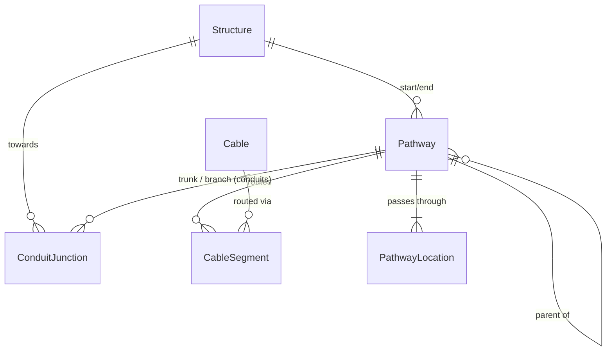

# Concepts

This page explains the core data model and how the different components of NetBox Pathways relate to each other.

## Data Model Overview

## Structures

A **Structure** is any physical location where cables can enter, exit, or transition between pathway types. Structures have geographic coordinates (Point or Polygon geometry) in their `geometry` field, and can be assigned to a NetBox Site and to a Location within that site.

| Category | Types |
|----------|-------|
| **Outdoor** | Pole, Manhole, Handhole, Cabinet, Vault, Pedestal, Tower, Roof |
| **Indoor** | Equipment Room, Telecom Closet, Riser Room, Building Entrance |

Structures serve as endpoints for Pathways, including conduit banks.

A structure is a *container*. Equipment that lives inside one -- a splice
closure, for instance -- is a `dcim.Device` assigned to the same site and
location, not a structure in its own right.

## Pathways

A **Pathway** is a physical route between two endpoints. It has a LineString geometry (the geographic path) and connects structures, locations, or junctions.

Every pathway is one record of the `Pathway` model; its `pathway_type`
decides its type-specific fields:

| Type | Description | Key Fields |
|------|-------------|------------|
| **Conduit Bank** | Encased group of conduits on one route | Configuration, total conduits, encasement |
| **Conduit** | Pipe or duct | Material, diameter, depth, position in its bank or raceway |
| **Aerial Span** | Overhead route | Attachment height, sag, messenger, wind/ice loading |
| **Direct Buried** | Underground without conduit | Burial depth, warning tape, tracer wire, armor |
| **Innerduct** | Smaller duct inside another pathway | Size, color, position |
| **Cable Tray** / **Raceway** / **Submarine** | Tray, enclosed channel, underwater route | Common fields only |

A pathway may sit inside another one through its `parent`: conduits in a bank
or raceway, innerducts in a conduit, tray, direct buried pathway or another
innerduct. The [containment rule](pathways.md#containment-rule) decides which
types may contain which. Only top-level conduit banks, conduits, aerial spans,
direct buried and submarine pathways are drawn on the map.

### Endpoint Flexibility

Pathways support flexible endpoints to model both outdoor and indoor infrastructure:

- **Structure** -- A pole, manhole, or other physical structure
- **Location** -- A NetBox `dcim.Location` (room, floor, wing)
- **Junction** -- A conduit junction (Y-tee), for conduits only

Each pathway has exactly one start endpoint and one end endpoint. These can be different types (e.g., a conduit starting at a manhole and ending at a building location). A location endpoint still belongs to a structure -- the nearest one enclosing it; see [How Pathway Ends Attach to Structures](attachment.md).

## Conduit Banks

A **Conduit Bank** is a pathway of type `conduit_bank`: an encased group of conduits sharing one route between two structures. Banks have a configuration (e.g., 2x3 for 2 rows by 3 columns) and track the total number of openings.

Conduits are placed in a bank by setting their `parent` to the bank, with a **Position** (e.g., `A1`, `B2`). Each position within a bank is unique. A conduit in a bank inherits the bank's endpoints and route when it has none of its own. See [Conduit Banks](conduit-banks.md).

## Conduit Junctions

A **Conduit Junction** models a Y-tee where a branch conduit meets a trunk conduit at a point along its span. Key attributes:

- **Trunk Conduit** -- The main conduit being tapped
- **Branch Conduit** -- The conduit branching off
- **Towards Structure** -- Which end of the trunk the junction faces
- **Position on Trunk** -- Normalized position (0.0 to 1.0) along the trunk

The junction's geographic location is interpolated from the trunk conduit's path geometry.

## Cable Segments

A **Cable Segment** links a NetBox `dcim.Cable` to a Pathway. Multiple segments trace a cable's complete physical route:

| Field | Description |
|-------|-------------|
| **Cable** | The NetBox cable being routed |
| **Pathway** | Which pathway this segment traverses |
| **Sequence** | Order of this segment in the route (1, 2, 3...) |
| **Enter/Exit Points** | Geographic coordinates where the cable enters and exits the pathway |
| **Slack Length** | Extra cable length stored at this segment |

Cable segments ordered by sequence form a complete **pull sheet** for field crews.

## Pathway Locations

A **Pathway Location** records intermediate waypoints along a pathway's route — locations the pathway passes through between its start and end. Each waypoint references a NetBox Site or Location and has a sequence number for ordering.

## Site Geometry

A **Site Geometry** links a NetBox Site to the Pathways geospatial system. It can hold an explicit geometry or fall back to a linked Structure's location. This model enables external plugins to reference Site-based geometry through the [Map Layer Registry](../developer/map-layer-registry.md).

## Relationship to NetBox Core

NetBox Pathways integrates with several core NetBox models:

| NetBox Model | Relationship |
|-------------|--------------|
| `dcim.Site` | Structures belong to Sites; PathwayLocations reference Sites |
| `dcim.Location` | Pathway endpoints can be Locations (indoor routing) |
| `dcim.Cable` | CableSegments link Cables to Pathways |
| `tenancy.Tenant` | Structures and Pathways support tenant assignment; a pathway without one shows its nearest ancestor's |
